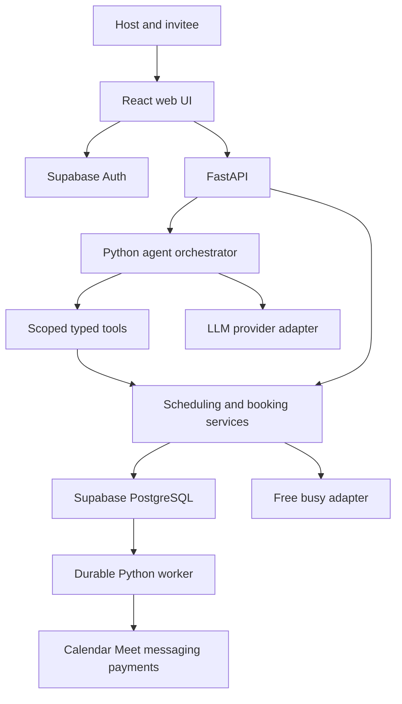

# PetiteCalendar-ai architecture

For the current implemented release, start with the [functional specification](SPEC.md), [high-level system diagrams](HIGH_LEVEL_DESIGN.md) and [low-level implementation design](LOW_LEVEL_DESIGN.md). This architecture document also preserves future design direction; payments, reminders, WhatsApp, Mutual Match and teams are not implemented core features. The specification was reconstructed from the code and reviews, rather than supplied with the original kit.

Build a Python scheduling application backed by Supabase, with an agent that turns natural-language intent into validated scheduling actions. FastAPI owns the domain rules; a Python worker performs durable external side effects. A React frontend preserves the Midnight design. Implement one functionality at a time and stop for review.

Booking-dependent React views use visible/online polling every 15 seconds, focus/reconnection refresh and same-origin tab invalidation after successful commands. This refreshes public slots, private delivery/lifecycle status and host booking/Focus Guard counts without reloading contact drafts. PostgreSQL remains authoritative; no browser invalidation message contains booking details or capabilities. Guests open shared event links without authentication; homepage host sign-in and guest link entry are separate.

The user selected Python, Supabase and agentic AI on 11 October 2026, superseding the kit's technology choices. This proposal preserves its functionality; it is not the missing Product and Technical Design Spec.

## Requirements and boundaries

| Capability | Source | Treatment |
| --- | --- | --- |
| Host, agent, booking link, invitee selection and confirmation | Hosting-calendar.drawio.html | Agent and UI use the same domain services |
| Duration choices and both timezones | Desktop and mobile booking screens | Core booking flow |
| Mutual Match and Show anyway | Mobile screen and event editor | Temporary invitee free/busy filtering |
| Notice, buffers, daily event caps | Event editor | Deterministic availability rules |
| Focus Guard caps, weekly hours, blocks and clustering | Dashboard and event editor | Hard protection rules and soft slot ranking |
| Meet, calendar download, reschedule and cancellation | Confirmation screen | Booking lifecycle |
| Approval, alternatives, payments and deposits | Dashboard and event editor | Explicit policy and lifecycle states |
| Email, reminders, WhatsApp, Razorpay and Stripe | Original CODEX_PROMPTS.md in ZIP | Separate integration milestones |
| Polls | Navigation only | Defer until behaviour is specified |

The kit references docs/SPEC.md for exact schemas, algorithms, APIs and onboarding, but the file is absent. The five HTML screens use design-canvas template elements and a missing support.js; they are visual references, not application code. Sample prices and caps are examples, not global defaults.

## Selected stack

| Layer | Choice | Purpose |
| --- | --- | --- |
| Frontend | React, TypeScript, Vite and CSS tokens | Interactive calendar and assistant, compiled to static files |
| Backend | Python FastAPI and Pydantic | Typed APIs and tools with an OpenAPI contract |
| Domain | dataclasses, datetime and zoneinfo | Pure scheduling rules and IANA timezones |
| Persistence | Supabase PostgreSQL, SQLAlchemy, Alembic | Reservations, policy snapshots and explicit migrations |
| Identity | Supabase Auth | Google login and email magic links; one identity system |
| Agent | Bounded Python tool-calling orchestrator and provider adapter | Interpret intent, clarify, propose and execute validated actions |
| Background work | Python worker, PostgreSQL jobs and transactional outbox | Leased execution, retries, reminders and reconciliation |
| Integrations | Google Calendar/Meet, Resend, WhatsApp, payment adapters | Replaceable external services |
| Quality | pytest, Ruff, TypeScript and Playwright | Domain, database, agent and browser checks |

Python suits the backend and agent; the interactive browser still uses JavaScript. Supabase provides data and identity rather than replacing booking business logic. FastAPI supports OpenAPI and schema documentation ([official docs](https://fastapi.tiangolo.com/features/)); zoneinfo provides IANA timezone support ([Python docs](https://docs.python.org/3/library/zoneinfo.html)). Pin compatible runtime versions during scaffolding.

## Components

The agent and conventional UI use the same services. The pure engine accepts configuration, busy intervals, bookings and an injected current time. It performs no I/O. PostgreSQL is authoritative for PetiteCalendar-ai reservations; external calendars remain authoritative for events created elsewhere.

Serve the compiled frontend and API behind one origin, initially from FastAPI. Run the worker separately using the same Python package. Use separate development, staging and production Supabase projects with API and worker near the database. Choose hosting and backup settings at deployment; no services are provisioned by this proposal.

Private staging adds an application access gate before routing, independent of Supabase host authorization. HTTPS, a strong access password and encryption key are required; invalid configuration denies access. The health endpoint remains available to the hosting platform. A successful browser challenge creates a short-lived encrypted Secure/HttpOnly cookie so normal bearer authentication and browser OAuth callbacks still work. This gate is only for restricted staging review.

## Data model

| Entity group | Responsibility |
| --- | --- |
| Host profile | Supabase user ID, unique username, display name, IANA timezone and branding |
| Event and duration options | Slug, description, selectable durations, location, publication and prices |
| Schedule and overrides | Local weekday windows, timezone, date overrides and event assignment |
| Focus Guard | Host daily cap, weekly minute cap, focus windows and clustering preference |
| Calendar connection | Selected blocking calendars, destination calendar, encrypted tokens and health |
| Booking and reservation | UTC times, invitee timezone, contact details, lifecycle, active blocked range, hold expiry, policy and buffer snapshots |
| Booking change | Original and proposed times, approval, alternatives and revision |
| Payment and webhook receipt | Provider IDs, integer minor-unit amounts, currency and deduplication |
| Job, delivery and outbox | Due time, leases, retries, revision, operation key and committed domain events |
| Agent proposal and audit | Scoped actor, exact typed arguments, confirmation, expiry and redacted outcome |

Persist instants as UTC timestamptz. Recurring schedules are local wall times plus an IANA timezone, never a fixed UTC offset. Snapshot booking policy, price and buffers so future settings edits cannot silently change existing commitments.

Separate reservation lifecycle, payment state and integration delivery state. A confirmed booking can have a calendar operation awaiting retry without releasing its slot. Suggested booking states are payment_pending, confirmed, cancelled and expired. Rescheduled remains a confirmed booking with a new revision; approval belongs to a booking-change request. Finalize names at schema review.

## Availability and concurrency

1. Expand recurring hours and overrides in the schedule timezone and resolve DST explicitly.
2. Generate UTC candidates for the selected duration and start interval.
3. Exclude busy periods, active reservations, buffers and focus blocks.
4. Apply notice, horizon, event/host daily caps and weekly minute limits.
5. Intersect with temporary invitee busy intervals when Mutual Match is enabled.
6. Rank valid slots for clustering; render results in the invitee timezone. Ranking cannot make an invalid slot bookable.

Before reserving, fetch recent external occupancy, then enter a short transaction: lock the host, release expired holds, recheck local rules and counts, and insert or replace the reservation. All booking, hold, reschedule and policy writers take the same host lock. Add a host-wide exclusion constraint over active half-open tstzrange intervals, including buffer snapshots. PostgreSQL supports range exclusion constraints and btree_gist ([PostgreSQL docs](https://www.postgresql.org/docs/current/rangetypes.html)); Supabase lists btree_gist as available ([extension docs](https://supabase.com/docs/guides/database/extensions)).

Host locking also protects aggregate caps, which exclusion alone cannot enforce. Return 409 on contention and refresh slots. Do not perform slow provider calls while holding the transaction. Google and PostgreSQL cannot commit atomically: an external event created in that interval may conflict, so reconcile and surface integration status rather than promising impossible external atomicity.

## Supabase identity and access

Use Supabase Auth, not a second identity framework. Configure asymmetric signing keys; FastAPI verifies JWT signature, issuer, audience and expiry using JWKS and a maintained library ([Supabase JWT docs](https://supabase.com/docs/guides/auth/jwts)). Public invitees can book without accounts.

Application tables live in a private schema excluded from the browser Data API. Browser business requests go through FastAPI. SQLAlchemy uses a restricted server role and explicit tenant scoping. Where RLS is used, set verified identity transaction-locally: direct database connections do not automatically inherit browser JWTs or auth.uid(). Test connection pooling for cross-host leakage. Workers have a separate restricted role; secrets and service credentials never reach the browser.

Google login and Calendar consent are separate responsibilities. Handle selected calendars, offline access, encrypted refresh tokens, revocation and reconnect explicitly. Supabase does not refresh provider tokens for the app ([social login docs](https://supabase.com/docs/guides/auth/social-login)).

## Agent capabilities and confirmation

Step 9 implements one bounded OpenAI Responses function call per request, with strict allowlisted Pydantic tools selected by verified scope. The Python orchestrator validates the call and runs the shared services; the model never receives arbitrary write access. Input history is at most six user messages of 1,000 characters each and lives only in browser memory. The adapter redacts common email/phone/key/link/capability patterns, sends numeric scheduling settings and dates rather than stored contacts or calendar contents, and sets `store=false`. This flag does not claim zero provider retention under all account policies.

Existing event and saved schedule settings are merged with typed patches and validated by their ordinary API models. Fernet proposals contain exact validated values, target revision, actor/capability scope and a 15-minute expiry. Confirmation uses the existing host-locking repositories. Exact settings retries recognize the matching next revision without writing again; changed revisions conflict. Cancellation wraps the existing idempotent lifecycle command. New booking and reschedule suggestions feed the conventional explicit review/form and reservation service; suggested times have no holds and are freshly checked when committed.

After Step 9 usability feedback, the model uses page context instead of repeatedly asking for the event, duration or selected zone. Undated searches default to the next seven days in that zone; unspecified hours use the full day. Contact prefill is a separate authenticated application feature: `/api/me/booking-contact` derives the user's own profile name and email from verified Supabase identity. A shared public-page form context preserves contact edits across time changes in memory only, and never sends them to the model. Unknown guests supply their own contact once. Current/travel-zone review and explicit booking confirmation still apply.

No new DB schema or general conversation/audit store is introduced in this increment. Existing target revisions and the booking-action journal record effects. The live evaluation records only case names, tool names, pass/fail, latency and token counts, with synthetic data. Preview limits are four simultaneous requests, 20 per actor/IP per hour and 200 globally per hour, plus 14-day time searches and 1,800 output tokens. These process-local limits must become shared limits before multiple API replicas or public release. The conventional UI remains available on provider refusal, invalid output, timeout or billing failure. Initial model access and three normal live interpretation cases passed; a provider rate limit prevented a complete repeated evaluation. Model comparison and account-specific currency cost remain unmeasured.

The agent helps hosts draft event types and schedules; helps invitees find times in natural language; proposes valid reschedules; and explains Focus Guard or saved cancellation policies. These support existing scheduling goals rather than adding an unrelated chat product.

Use a single orchestrator with interpret, clarify, fetch, propose, confirm, execute and report states. Select the LLM provider/model through measured accuracy, latency and cost at the agent milestone. No vector database, retained chat memory or multi-agent framework is needed initially.

| Tool group | Examples | Boundary |
| --- | --- | --- |
| Read | list_available_slots, get_event_type, get_booking_policy, explain_exclusion | Current host identity or scoped invitee capability |
| Draft | draft_event_type, propose_booking, propose_reschedule | Reviewable proposal; no external side effect |
| Mutate | apply_draft, confirm_booking, confirm_reschedule, cancel_booking | Matching confirmed proposal and fresh domain validation |

Bind confirmation to actor, exact arguments, revision and expiry. A natural-language yes only accepts the matching outstanding proposal; edited details invalidate it. Payment authorization comes from checkout. Tools cannot execute arbitrary SQL, impersonate a host, send arbitrary messages or bypass caps. Calendar and invitee text is untrusted content and cannot grant permissions.

Send the model minimal event metadata and engine-approved slots, not raw busy events, tokens, contact details or payment data. Keep invitee conversation context ephemeral by default; persist confirmed actions and redacted audit metadata. Enforce tool, time and token budgets. Fall back to the conventional calendar when the provider fails. Evaluate tool arguments, confirmation and domain outcomes, not just response wording.

## Integration durability

Commit mutations, jobs and outbox events together. Workers claim jobs with leases and SKIP LOCKED, recover abandoned leases and retry with backoff. Durable unique operation keys protect against repeated webhooks and worker delivery. Provide failed-job inspection and reconciliation; in-process request background tasks are insufficient.

Create one Google event using a stable event ID and reconcile ambiguous outcomes before retrying. Request a unique Meet conference with conferenceDataVersion=1 and createRequest ([Google event docs](https://developers.google.com/workspace/calendar/api/v3/reference/events/insert)). Fetch occupancy with free/busy rather than event contents ([free/busy docs](https://developers.google.com/workspace/calendar/api/v3/reference/freebusy/query)). Track calendar, email and ICS delivery separately from reservation confirmation.

Reminders carry booking revision and recheck current state before sending. WhatsApp requires explicit recorded opt-in. Paid bookings use the kit's proposed 15 minute hold. Serialize capture and expiry under the same locks; verify webhook signatures, amounts and currency and deduplicate events. Late capture cannot reclaim a slot already taken; reconcile/refund according to the approved policy.

Mutual Match processes temporary read-only invitee busy data without persisting event contents or sending them to the LLM. Multi-request matching requires a reviewed transient credential design and cleanup. Privacy copy must describe temporary access accurately before claiming nothing is saved.

## Decisions at feature review

| Decision | Proposed boundary |
| --- | --- |
| Slot increment and horizon | Configurable; first demo uses 15 minute starts and a bounded date window |
| DST | Skip nonexistent times; ambiguous choices show explicit offsets |
| Buffers | Exclude overlapping expanded reservations, so adjacent before/after buffers add |
| Cap accounting | Active holds count; weekly minutes exclude buffers; host zone defines days/weeks |
| Cross-midnight | First release uses windows contained within one host-local day |
| Reschedule approval | Keep original booking until approval. Up to three available alternatives when enabled; proposals are not held and approval rechecks availability |
| Duration pricing and deposit balance | Support configurable amounts; collection/refund rules require payment review |
| Agent autonomy | Read and draft; explicit bound confirmation for mutations |
| Polls and team scheduling | Defer until functional behaviour is specified |

## Code organization

backend/app contains api, domain, services, db, agents, integrations and worker modules. backend/migrations owns Alembic changes; backend/tests covers domain and integration cases. frontend/src contains components, pages, api and styles. docs records design, decisions and feature reviews.

The first functionality uses a clearly labelled demo host and schedule adapter. Supabase persistence, Auth, connected calendars and agent execution arrive in separate review milestones; demo slots must not imply connected-calendar availability.

## Current and travel timezone

Step 4 stores one host schedule in `app_private.availability`: independent IANA timezone, local weekly windows, date overrides, recurring focus windows, caps, increment, enabled flag and clustering preference. Schema changes use Alembic. Private writes lock the host profile and check revisions; public computation uses a restricted publication-scoped read. The pure engine produces slots and broad exclusion reasons. A date override replaces the recurring windows for that day. Recommendations only rank valid choices near supplied actual meeting intervals. No occupancy is invented before bookings/calendar adapters are implemented. Future reservation writers must use the same profile lock and feed saved bookings/holds/counts into this established service.

Default the invitee display timezone to the device setting and allow the current travel zone. Device settings are suggestions, not verified physical location. Before each selected-time review, ask the invitee to confirm the displayed zone or change it. Changing it recalculates availability and clears the selection without changing the host schedule zone. Recheck device settings before opening the confirmation when using automatic selection. No location permission or IP geolocation is needed.

## Host identity implementation

Step 5 adds private `bookings` and `booking_outbox` tables. The booking repository resolves a published route, takes the same host-profile lock as event/schedule writers, rechecks publication, route, schedule, notice, horizon, duration, focus and aggregate counts, and inserts a confirmed reservation with buffered UTC bounds. A partial GiST exclusion constraint prevents host-wide overlap even if a writer misses the lock. Confirmation and a unique booking-confirmed outbox event commit together. Later integration workers will consume durable events; no external delivery is claimed in this milestone.

Public computation injects confirmed reservations and their saved buffer bounds into the pure engine, recalculating daily/week counts in the current schedule timezone. Booking snapshots preserve event title/location, host name/timezone, policy cutoffs, buffers and event revision independently of subsequent settings edits. Host dashboard reads use verified identity and private RLS, host-local month boundaries and an independent complete current-week query.

The public booking service uses its own NOLOGIN role and transaction-local host/capability scope, without profile/event/schedule write policies. The browser creates a 256-bit random capability; PostgreSQL stores only its SHA-256 digest. Private links carry that capability in the URL fragment, and reads send it in a header, never the request URL. Booking IDs alone grant no access. No-referrer/no-store headers and disabled access logging protect the confirmation path. Idempotency UUIDs are unique, bound to a digest of exact route/arguments including the capability; identical retries recover the same booking even after unpublishing. Within the form, uncertain outcomes freeze details and retry the original command. Confirmed-link retention is required until email delivery arrives.

The user approved a core-first delivery sequence on 11 October 2026: event types, availability, free booking, Google Calendar/Meet and email/ICS. The stack and full functionality scope remain unchanged. The AI assistant and other improvements are sequenced with the user after the core review, as recorded in the implementation plan.

Step 3 adds event types with host-scoped unique slugs and optimistic revisions. Host mutations lock the profile and run under the API role/RLS. Public metadata reads use a separate NOLOGIN role that can read published events and selected host columns under publication policies; API responses whitelist public fields. A published event page initially shows saved details without slots until persisted availability is built. Event-specific limits and management cutoffs are saved now, then enforced by their scheduling/booking services as those milestones arrive.

The SPA uses Supabase's PKCE session flow, refreshes sessions through the SDK, and sends access tokens to FastAPI. The backend independently verifies asymmetric signatures against the configured project's JWKS and validates issuer, audience, expiry, required claims, role and UUID subject. Client-supplied ownership is forbidden. Callback query parameters are cleared immediately and access logging is disabled. Email token hashes are verified by the SDK; Google authorization codes are exchanged once even under React StrictMode.

Step 2 introduces `app_private.host_profiles` via Alembic, keyed to `auth.users.id`, with a unique username and IANA home timezone. Profile queries use both explicit actor filters and PostgreSQL RLS under `petitecalendar_api`, a restricted NOLOGIN role. Actor context and role changes are transaction-local, preventing pooled connections from carrying identity into later requests. The schema is outside the exposed Data API. Development migrations grant role membership to the connection account; provision a separate runtime login with only role membership before release. Public availability remains a labelled demo until event management and persisted scheduling are introduced.

## Google Calendar and Meet implementation

Step 6 uses an official OAuth Flow adapter with PKCE and offline consent. Hashed, cookie-bound state expires after ten minutes and is consumed once. Fernet envelopes bind refresh tokens and verifier ciphertext to the host. Access tokens stay transient. Fixed callback redirects, no access logging and generic provider errors protect credentials.

Private Google connections, consent states and calendar jobs have forced RLS. Calendar-service and worker roles are separate from public booking and host API roles; the booking role cannot select ciphertext and the worker cannot select guest email. Settings/disconnect take the shared host-profile lock with optimistic revisions. The destination calendar is always included in selected busy checks. Connected-provider failures stop availability; local reservations still determine caps.

Reservation fetches external busy intervals before its database transaction, then locks the host, compares connection generation/revision/status and rechecks policy/local occupancy. It atomically saves a confirmed booking and job pinned to account generation, destination and Meet choice. Google cannot share the PostgreSQL transaction; external events created after free/busy may still race. Existing bookings are not backfilled.

The separate worker leases jobs with SKIP LOCKED, recovers expired leases and rejects stale finishes. It checks booking revision/account generation before delivery. Deterministic event IDs and Meet request IDs recover uncertain inserts; existing events require matching private markers and exact times. Manual changes need attention. Bounded retries preserve the reservation. Disconnect erases the token locally; reconnecting the same Google account preserves generation, while switching accounts invalidates old jobs. Host events exclude email/attendees and send no invitations. Email/ICS remain Step 7; lifecycle synchronization and production supervision remain future work.

## Booking email and ICS implementation

Step 7 queues one invitee confirmation per booking/revision when email is configured. The job references the booking-confirmed outbox record and commits with the reservation. Existing bookings are not backfilled. The private capability remains hash-only on the booking row; a host-bound encrypted copy lives temporarily in the email job so a worker can build the invitee link. Host/public reads are granted only status columns. A separate email-worker role can read the necessary guest contact/snapshot fields and update jobs; the Calendar worker retains its prior narrower grants.

Email delivery uses SKIP LOCKED leases, expiry recovery and guarded completion. It waits up to ten minutes for Calendar/Meet, then freezes an encrypted message body and ICS attachment before first submission. Every retry uses that immutable body and a stable booking/revision idempotency key. Resend deduplicates for 24 hours; automatic retries stop at 23 hours after freezing. Ambiguous terminal outcomes are marked uncertain instead of being resent later. Ciphertext containing links/messages is cleared on terminal completion. Booking confirmation remains independent of email success. Provider acceptance is labelled Accepted; inbox delivery is a manual review until signed delivery-webhook support is added.

Private calendar downloads require the existing capability header, not a URL/query token. RFC 5545 files use UTC DTSTART/DTEND, stable booking UID, saved revision and creation stamp, escaped text and UTF-8 octet folding. Both zone labels appear in the description; calendar apps choose their display zone. The file contains no guest email or private capability link. It publishes a calendar entry without sending organizer/attendee invitations. Meet is included once ready. New downloads reuse UID after Meet arrives; client import/update behaviour varies.

## Cancellation and rescheduling implementation

Step 8 uses the existing private booking capability or verified host identity. Every command binds a UUID idempotency key to the exact actor, booking, arguments and expected revision. Replays recover the current booking without repeating effects. Invitee deadlines use saved policy snapshots and reject the exact deadline; the host may cancel or move a future meeting until its start. Neither actor can change a cancelled or started booking.

Rescheduling keeps the saved duration and buffers while checking the current host schedule, notice, horizon, focus protection and caps. The pure engine excludes the original reservation from intervals and aggregate counts. A selected Google calendar containing this booking is checked with a minimal events list, excluding only deterministic event IDs with matching private booking/revision markers. Overlapping unrelated events are preserved; other selected calendars retain free/busy checks. Event titles, descriptions and attendees are not requested, stored or logged. Google list/delete contracts: https://developers.google.com/workspace/calendar/api/v3/reference/events/list and https://developers.google.com/workspace/calendar/api/v3/reference/events/delete.

Provider reads precede the host-profile lock. Under that lock, the service takes a per-booking transaction advisory lock, checks the current revision and connection stamp, revalidates availability, and replaces the reservation atomically. Cancellation changes status to cancelled, increments the revision and immediately releases the local reservation. A conflict rolls back and preserves the original. Actions, committed outbox events and Calendar/email jobs share the transaction. Private tables use forced RLS and separate column grants; change-request ciphertext is excluded from host API reads and all responses.

With saved approval enabled, an invitee can propose one time, or up to three when alternatives are enabled. A single pending request retains the original reservation and holds none of the proposals. The host reviews, selects and approves one alternative with fresh availability checks, or declines. Invitees can withdraw. Cancellation supersedes pending requests. The temporary capability is host-bound encrypted solely to put the private link in the approved change email; resolving the request erases it. Pending requests currently appear on the dashboard without separate notification emails or expiry automation.

Both delivery workers share the booking advisory lock with mutations. They load and validate the current revision before external effects. A new Calendar event uses the established deterministic ID for the new revision; only after successful creation/Meet does the worker remove previous owned events, including ambiguous prior inserts. Cancellation removes prior owned events. Deletes verify markers and use the returned ETag; missing/deleted events count as success. The original Google generation/destination stays pinned. Reconnecting a different account cannot delete events in the original account; failed cleanup stays visible for manual attention. Delivery is eventually consistent: old Google occupancy may remain while cleanup retries, and a reschedule can create a new Meet link.

Invitee emails describe confirmed reschedules or cancellations and include the stable-UID calendar attachment with an increased SEQUENCE and current update timestamp. Cancelled files use STATUS:CANCELLED and METHOD:PUBLISH; import/update behaviour still depends on the calendar client, and the app sends no Google attendee invitations. Host-initiated changes cannot reconstruct a hashed private capability, so their email refers to the original private link instead. Retry payload/key freezing and the 23-hour uncertainty boundary remain unchanged. Resend stays in test mode at the user's request.

## Staging packaging

The runtime container explicitly copies the backend, migrations and built SPA, using lockfiles and a non-root user. Web and worker are supervised separately. The staging Compose binding is localhost-only on port 8027; hosted privacy requires a private ingress or access gateway. Keep one API process/replica until shared assistant limits exist. Migration credentials and staging provider/database resources are separate from development and production. See [staging setup](STAGING_SETUP.md).

## Host notifications and guest history — local review increment

Migration `0010_host_guest` passed local verification and was applied to hosted storage after the user's 12 October deployment approval. New reservations atomically enqueue `host_email_jobs` alongside the existing guest job. The same worker process runs a separate host consumer with independent leases, status, frozen encrypted payload and `host-booking-confirmed/{booking}/{revision}` keys. A narrow security-definer function resolves only the job owner's verified Auth email; the email worker receives no general `auth.users` privilege. Host messages contain no guest management capability. Existing reservations and host lifecycle notifications are outside this increment.

Guest authentication verifies the JWT using the existing project JWKS, then reads Supabase Auth's current user with that bearer token. The subject and current confirmed email must match the signed identity. The API derives the email scope server-side and sets it transaction-locally under `petitecalendar_guest`. Explicit predicates and forced booking/job RLS restrict history to that inbox; only whitelisted fields leave the API. New API responses are private/no-store/no-referrer. Guests need no host profile and cannot obtain private management capabilities from history. Reusing Supabase Auth avoids an additional identity store or paid service. Public magic links need custom SMTP; existing Resend can provide it after approval.
