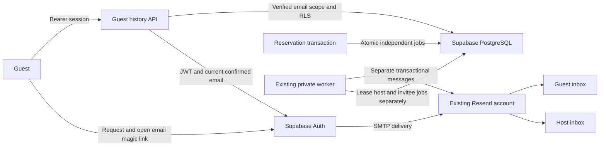
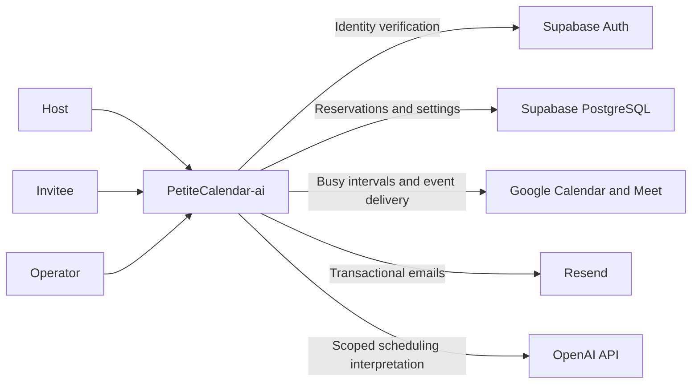
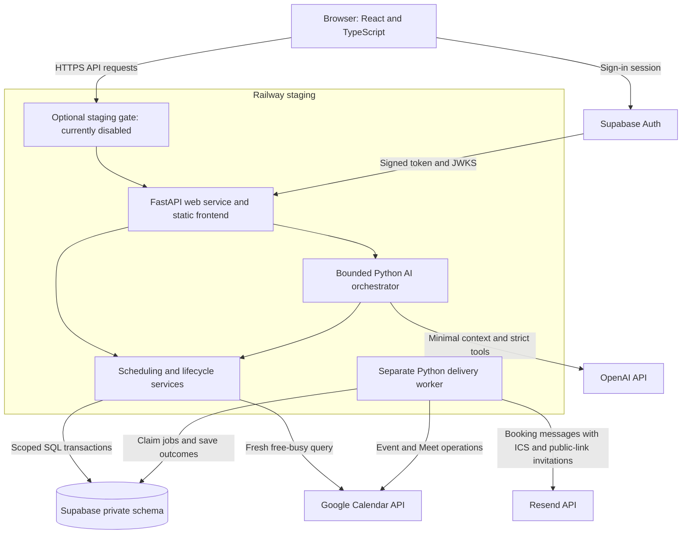
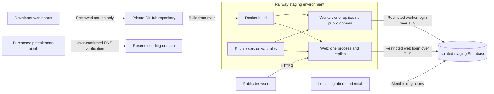

# PetiteCalendar-ai high level system design

## Approved additions — 12 October 2026

This flow passed local checks and user review on 12 October 2026. The hosted schema is migrated; code release and live SMTP acceptance are separate verification steps.

Ordinary guest booking remains unauthenticated. History requires inbox verification and does not expose other guests or management secrets. This increment creates no new hosting service. Deployment is approved; live SMTP delivery remains an acceptance step.

Version 1.2, 11 October 2026. This is the current system design for the functionality in [the specification](SPEC.md). The existing Railway environment is open for a user-approved public weekend release. The optional staging gate is disabled; host and booking authorization remain active. Google OAuth is still in Testing. Future integrations from the original kit are excluded from these diagrams.

## System context

The host controls meeting offerings and schedule policy. The invitee can book without a Supabase account; their private booking link provides narrowly scoped management access. Google sign-in and Google Calendar consent are separate flows with different callbacks.

## Runtime components

FastAPI serves both the compiled frontend and API from one origin. The frontend never receives database passwords or provider secrets. The scheduling engine is pure Python; services load settings and occupancy, invoke it and translate its results into API responses.

Supabase PostgreSQL is authoritative for application reservations. Google calendars supply external busy intervals and receive a copy of committed meetings. The worker performs slow delivery independently of the web request. Delivery failure does not undo a confirmed reservation.

AI is an optional interface to existing services. The model chooses allowlisted typed tools; Python validates tool arguments and enforces scope. The model cannot issue SQL, impersonate a host or override scheduling constraints.

## Deployment and trust boundaries

The migration credential stays local; web and worker use separate restricted database logins. Secrets remain outside GitHub. The worker has no public ingress. Production is not a separately provisioned environment in this diagram.

When enabled, private staging uses a password challenge followed by an encrypted Secure/HttpOnly browser cookie with an eight-hour lifetime. Only `/api/health` bypasses that gate. The gate is disabled for the user-approved public weekend release. Supabase host authorization remains required for host operations.

The purchased domain is verified for email, web/worker sender settings have been updated and the user confirmed a new booking email reached their inbox. Public access was separately approved and enabled. The current website origin is `https://web-staging-1ecf.up.railway.app`; no website custom-domain change is implied.

Host event sharing uses the same web service, private database and delivery worker. Invitations are independently queued for reviewed guest addresses and contain only the public event link; they do not create bookings. The branded email has an HTML button and plain-text fallback. No additional hosting service or paid plan is introduced.

## Architectural decisions

| Decision | Reason and consequence |
| --- | --- |
| Python FastAPI backend | Keep scheduling rules, typed tools and provider adapters together; publish a typed API contract |
| React frontend | Support responsive date selection, forms and assistant proposals while preserving the supplied design |
| Supabase Auth and PostgreSQL | Use one identity system and relational transactions for reservations and policy enforcement |
| Modular application with separate worker | Keep deployment small while isolating delivery from request latency; no microservice overhead |
| PostgreSQL jobs and outbox | Commit required delivery work with the booking; leases support restart recovery |
| Host row lock and exclusion constraint | Serialize host-level caps and prevent overlapping buffered reservations across event types |
| Explicit AI confirmation | Make proposed changes reviewable and reject expired, edited or stale arguments |
| Separate reservation and delivery state | Report a committed booking correctly even while Calendar or email is retrying |
| Single web process/replica | Match current process-local AI limits; scaling requires shared limits first |

## Operating boundaries and next changes

Maintain the USD 20 monthly allowance and existing provider cutoffs. This design does not authorize paid upgrades. Current AI counters are local to the process and reset on restart; they are not a permanent account-wide budget mechanism. Provider billing controls remain necessary.

Before multiple web replicas, move AI limits to shared storage and review connection-pool capacity. Before a broader public launch, address rate-limit identity behind the hosting proxy, provider readiness, Google consent eligibility and verified email sending. The user has deferred backup/restore work, monitoring and additional launch checks for the weekend scope; those omissions remain explicit operating limitations.

Detailed modules, data relationships, transaction sequences and failure states are in [the low-level design](LOW_LEVEL_DESIGN.md).
