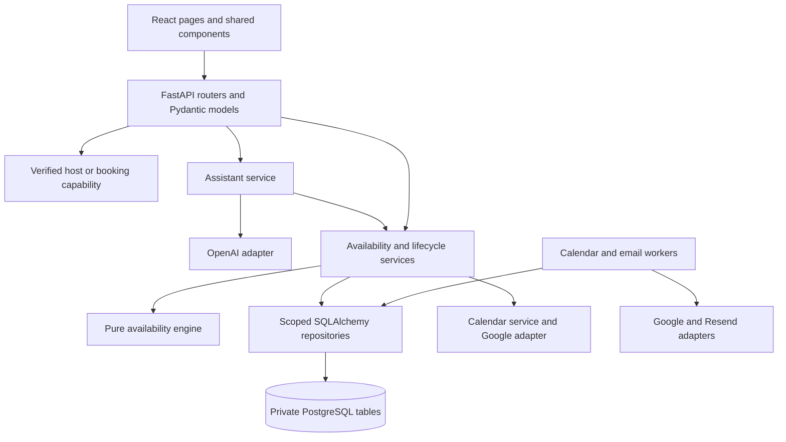
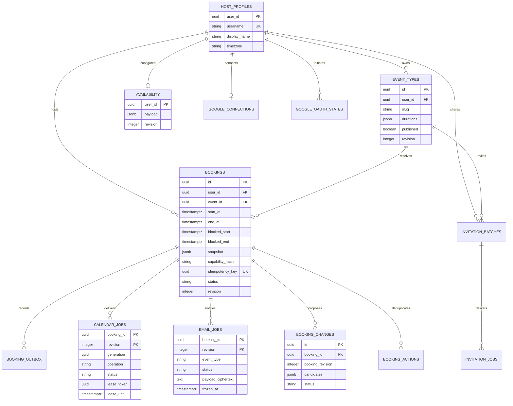
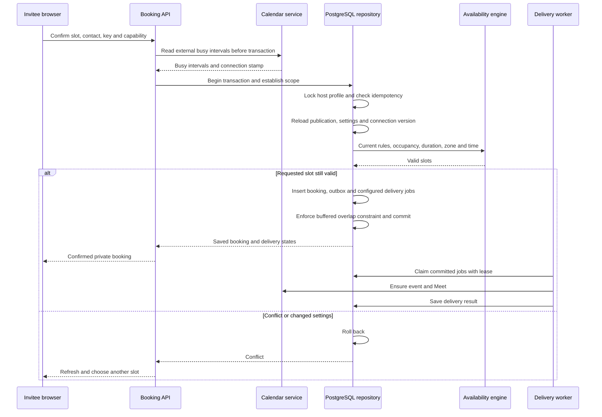
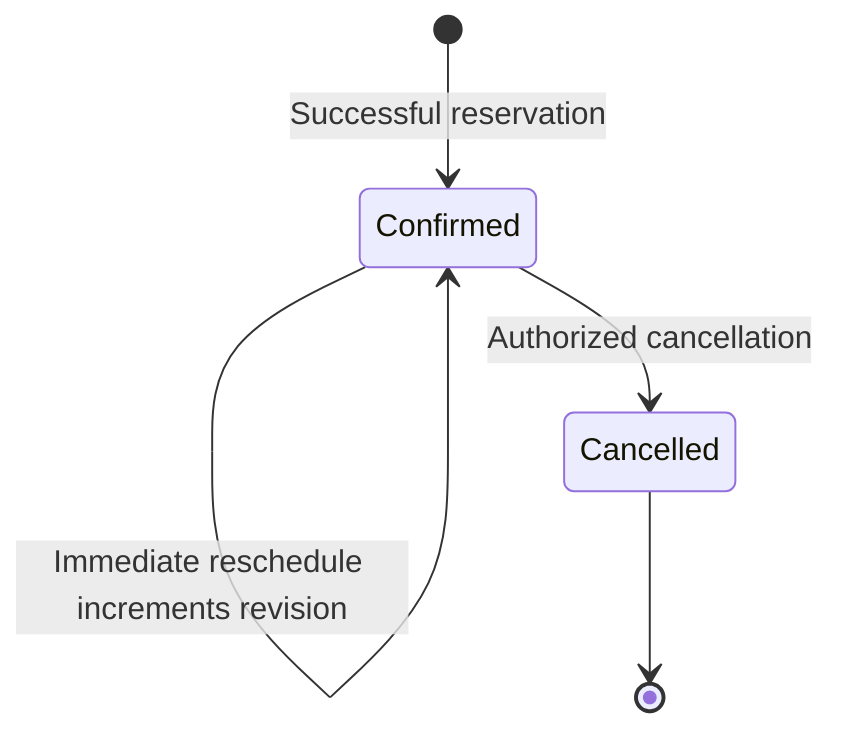
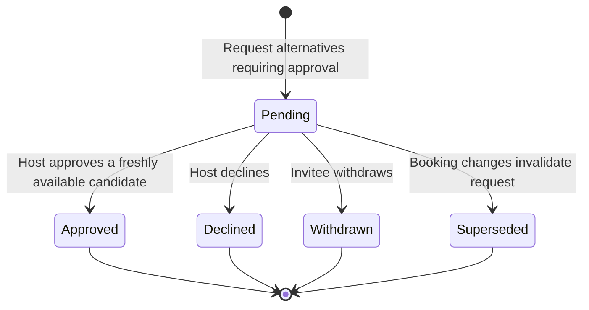
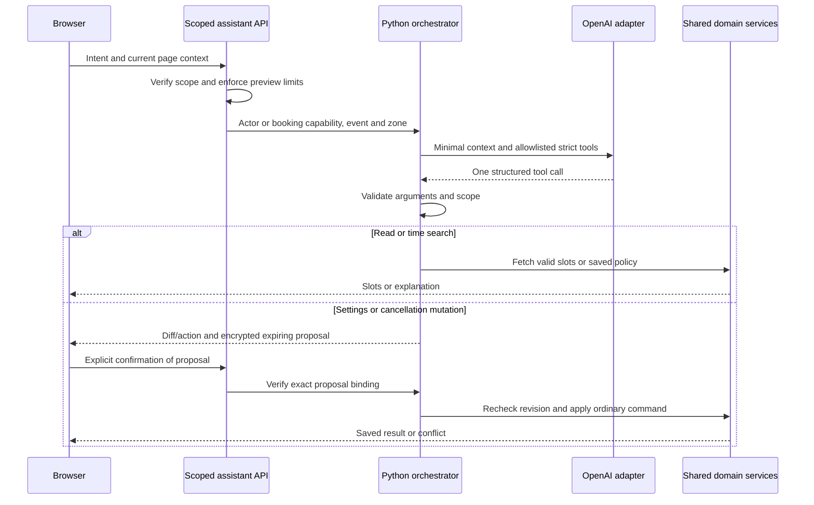

# PetiteCalendar-ai low level implementation design

## Local increment: host notification and guest history

These modules passed local checks and user review. The hosted migration `0010_host_guest` is applied and code deployment is approved:

| Module | Responsibility |
| --- | --- |
| `guest_auth.py` | Verify signed identity and match the current confirmed Auth email |
| `api/guest_history.py` | Validate filter/pagination; derive identity server-side |
| `db/guest_history.py` | Set transaction-local guest scope, use restricted role/RLS, return whitelisted history |
| `host_email_worker.py` | Independently lease and deliver host jobs using existing durable email behavior |
| `services/host_notification.py` | Escape host messages and link only to authenticated host management |
| `frontend/src/GuestDashboard.tsx` | Magic-link entry, filters, paging, refresh and read-only meeting cards |

```mermaid
sequenceDiagram
    participant Browser
    participant API
    participant Auth as Supabase Auth
    participant DB as PostgreSQL
    Browser->>API: GET /api/guest/bookings + bearer token
    API->>API: Verify JWT signature, issuer, audience and expiry
    API->>Auth: GET current user with caller bearer
    Auth-->>API: Current confirmed email and subject
    API->>API: Match current email and subject to JWT
    API->>DB: Begin; SET LOCAL ROLE guest; verified email scope
    API->>DB: Filtered, paginated SELECT under forced RLS
    DB-->>API: Only this guest's bookings and safe delivery fields
    API-->>Browser: Whitelisted history; private/no-store
```

Host-job insertion occurs in the same transaction as the new booking, outbox and invitee job. Both consumers retain revision guards, Meet waiting, encrypted immutable retry payloads, lease recovery and the 23-hour ambiguous-delivery boundary. Host messages never contain the guest's capability. Supabase default SMTP is insufficient for arbitrary guests; custom SMTP readiness must be checked before activation.

Version 1.2, 11 October 2026. This document maps the current code to the [functional specification](SPEC.md) and [high-level design](HIGH_LEVEL_DESIGN.md). The diagrams describe implemented relationships and control flow; they do not add future payment, team or reminder services.

## Module responsibilities

| Module | Responsibility |
| --- | --- |
| `backend/app/main.py` | Assemble FastAPI routers, response/error handling, health endpoint and compiled frontend routes |
| `backend/app/auth.py` | Verify Supabase JWTs and produce trusted host identity |
| `backend/app/staging.py` | Enforce the private staging gate and encrypted browser access cookie |
| `backend/app/api/` | Validate host, event, availability, booking, Calendar and assistant requests |
| `backend/app/domain/availability.py` | Compute valid UTC slots and ranking from injected rules, occupancy and current time; no I/O |
| `backend/app/services/availability.py` | Adapt saved schedule/event data to domain inputs and public results |
| `backend/app/services/lifecycle.py` | Apply cancellation/rescheduling policy, approval and transaction commands |
| `backend/app/services/calendar.py` | Coordinate consent, encrypted tokens, calendar selection and free-busy checks |
| `backend/app/services/assistant.py` | Build scoped tools/context, validate model output and confirm encrypted proposals |
| `backend/app/services/booking_email.py`, `icalendar.py` | Build booking messages and calendar files from saved state |
| `backend/app/db/` | SQLAlchemy mappings, restricted roles, scoped reads, locks and transactional repositories |
| `backend/app/integrations/` | Google, Resend and OpenAI adapters behind replaceable interfaces |
| `backend/app/worker.py`, `email_worker.py` | Claim leased jobs, perform revision-aware delivery and record retry/terminal states |
| `backend/migrations/versions/` | Nine ordered Alembic migrations for the current schema |
| `backend/app/api/invitations.py`, `db/invitations.py` | Host-scoped invitation validation, atomic queuing, exact-retry hashes and daily recipient limits |
| `backend/app/invitation_worker.py`, `services/event_invitation.py` | Durable per-recipient sending, encrypted frozen payloads and branded HTML/plain-text email |
| `frontend/src/` | Host pages, published events, booking management and shared assistant/form components |



## API contract map

| Method and route | Access | Purpose |
| --- | --- | --- |
| `GET /api/auth/config` | Application visitor | Public Supabase browser configuration, never server secrets |
| `GET /api/me` | Verified host | Identity and saved profile |
| `PUT /api/me/profile` | Verified host | Save onboarding/profile |
| `GET /api/me/booking-contact` | Verified user | Own contact prefill, outside AI context |
| `GET`, `POST /api/me/event-types` | Verified host | List and create event drafts |
| `PUT /api/me/event-types/{event_id}` | Verified host | Revise settings and publication |
| `POST /api/me/event-types/{event_id}/invitations` | Verified host | Queue reviewed recipients for a published event at the supplied revision |
| `GET /api/me/event-types/{event_id}/invitations/{batch_id}` | Verified host | Own batch delivery counts; no recipient list or message ciphertext |
| `GET`, `PUT /api/me/availability` | Verified host | Read/save shared schedule and Focus Guard |
| `GET /api/public/events/{username}/{slug}` | Visitor | Published event metadata |
| `GET /api/public/events/{username}/{slug}/slots` | Visitor | Valid slots for date range, duration and IANA zone |
| `POST /api/public/events/{username}/{slug}/bookings` | Visitor | Explicit idempotent reservation |
| `GET /api/bookings/{booking_id}` | Booking capability | Private saved booking |
| `GET /api/bookings/{booking_id}/calendar.ics` | Booking capability | Private calendar file |
| `GET /api/me/bookings` | Verified host | Bounded dashboard query |
| `GET /api/bookings/{booking_id}/slots` | Booking capability | Replacement-time search |
| `GET /api/me/bookings/{booking_id}/slots` | Verified owning host | Host replacement-time search |
| `POST /api/bookings/{booking_id}/actions` | Booking capability | Invitee cancel/reschedule/withdraw |
| `POST /api/me/bookings/{booking_id}/actions` | Verified owning host | Host lifecycle/approval actions |
| `GET`, `PUT /api/me/integrations/google` | Verified host | Connection status and calendar preferences |
| `POST /api/me/integrations/google/connect` | Verified host | Start separate Calendar consent |
| `GET /api/integrations/google/callback` | Bound OAuth state | Complete Calendar consent |
| `POST /api/me/integrations/google/disconnect` | Verified host | Disconnect with revision check |
| `POST /api/me/bookings/{booking_id}/calendar/retry` | Verified owning host | Retry permitted failed Calendar operation |
| `POST /api/me/assistant`, `/confirm` suffix | Verified host | Propose/confirm existing event or schedule settings |
| `POST /api/public/events/{username}/{slug}/assistant` | Visitor | Find valid event slots |
| `POST /api/bookings/{booking_id}/assistant`, `/confirm` suffix | Booking capability | Scoped booking assistance |
| `POST /api/me/bookings/{booking_id}/assistant`, `/confirm` suffix | Verified owning host | Scoped host booking assistance |

Private access uses the `X-Booking-Capability` header. The browser keeps the capability in a URL fragment, which is not sent as part of HTTP request URLs. Host access uses a verified Bearer token. The staging gate is an additional boundary on these routes.

Errors use `{ "error": { "code": "...", "message": "..." } }`. Input errors use 422, authentication failures 401, unavailable private resources 404, stale/contested changes 409, AI rate limits 429 and relevant configuration/provider failures 503.

## Persistence model

All listed application tables live in `app_private`. The diagram shows principal ownership and booking relationships; job identity includes the booking revision rather than just the booking ID.



The ER diagram lists selected fields, not a substitute for Alembic DDL. Each host can have many event types; slug uniqueness is scoped to the host. Availability contains timezone, weekly/override/focus windows and caps in a validated JSON payload. Booking snapshots preserve title, location, host context, buffers and change policies.

`google_connections` stores a generation, preference revision, selected calendar IDs, destination and encrypted refresh token. `google_oauth_states` stores hashed state/binding and an encrypted verifier with expiry. Calendar jobs keep provider IDs/Meet URLs; email jobs keep encrypted capability/message material. `booking_actions` stores request hashes for lifecycle idempotency. At most one pending `booking_changes` row is allowed per booking.

## Host invitations and live view updates

The host reviews exact recipients and a published event revision. The API locks the verified host profile and event, checks the request hash, then queues the batch and one encrypted immutable message per recipient in the same transaction. Limits are 10 recipients/request, 20 recipients/host/UTC day and 50 invitation recipients/app/UTC day; the global counter's atomic upsert prevents concurrent overspend of this allowance. The counter stores no contact details. These invitation limits do not replace provider billing cutoffs or include booking confirmation volume.

Host RLS policies restrict batch/status access; message ciphertext is not selectable by the API role. The existing email worker role claims invitation jobs with 90-second leases. A stable per-job Resend key, job delivery lock and frozen payload make automatic retries safe within the provider deduplication window. Stop retries after 23 hours from the first attempt; ambiguous terminal outcomes are uncertain. Terminal jobs clear encrypted messages. Provider acceptance is distinct from inbox delivery. No reservation or Calendar event is created by sharing.

Booking-dependent React views poll every 15 seconds while visible and online and refresh on focus/reconnection. Same-origin tab invalidation carries only a marker. Contact drafts and duration selections survive updates; taken slots clear with an explanatory notice. Host booking counts, invitee delivery status and shared-invitation status use the same visibility-aware refresh hook.

## Reservation transaction



The host lock serializes counts and settings writers. A partial GiST exclusion constraint independently forbids overlapping `tstzrange(blocked_start, blocked_end, '[)')` values for confirmed bookings of the same host. The idempotency key plus request fingerprint separates retries from conflicting reuse.

The outbox is a durable domain-event record. Calendar/email jobs are inserted directly in the same mutation transaction; the current worker claims those job tables. There is no separate outbox-dispatch daemon in this implementation.

## Booking and approval states





Rescheduling is a new revision of the same confirmed booking, not a third booking status. Pending alternatives do not reserve additional slots. Lifecycle changes recheck authorization, policy deadline, revision and occupancy under the locking discipline, then commit new integration jobs/outbox entries. Delivery operations also serialize per booking to avoid racing lifecycle changes.

## Worker delivery design

Jobs move from `queued` or due `retry` to `working` under a lease. Claims use `FOR UPDATE SKIP LOCKED`; an expired lease can be reclaimed. Lease ownership is checked before saving outcomes. Workers reject stale booking revisions and mismatched connection generations.

Calendar success is `synced`; permanent errors or the attempt limit become `failed`, otherwise the operation becomes `retry`. The provider adapter reconciles stable event identities and ownership before creating/retrying, and lifecycle delivery cleans up prior revision events. Google delivery is not a distributed transaction with booking commit.

Email success is `accepted`; retryable failure is `retry`, permanent failure is `failed`, and ambiguous outcomes can become `uncertain`. Both workers use bounded exponential delays, up to 300 seconds, with a 12-attempt boundary where applicable. Email waits up to ten minutes for an outstanding Calendar job before freezing a payload. The frozen encrypted payload and deterministic booking/revision/event key preserve provider retry semantics. After 23 hours from freezing, automatic resend stops before the provider deduplication window expires. Accepted does not prove inbox delivery.

## AI proposal sequence



Booking/reschedule suggestions use the ordinary booking/lifecycle form and its explicit review. Mutation tokens contain validated values, target revision, scope and a 15-minute expiry; Fernet authenticates and encrypts them. Confirmation never grants a broader role than the original caller.

The current assistant accepts at most six user messages of 1,000 characters each; allows four concurrent requests, 20 per actor/IP/hour and 200 globally/hour; bounds time searches to 14 days; and limits model output to 1,800 tokens. These counters are process-local. The dedicated provider spending cutoff supplies the separate billing boundary. A proxy-aware shared limiter is future work, not a current guarantee.

## Security and configuration boundaries

Supabase JWT verification checks signature, issuer, audience and expiry. Repositories select restricted roles and set trusted scope transaction-locally so a pooled connection cannot carry identity into a later request. Application RLS policies cover host access, published event reads, booking capabilities and workers.

Calendar OAuth uses state/binding and a verifier; refresh tokens remain encrypted server-side. Host consent preferences have generation/revision checks. Private responses use `Cache-Control: no-store` where configured and `Referrer-Policy: no-referrer`. Credential, contact and raw-provider payload logging is prohibited.

`APP_BASE_URL` determines hosted links/callbacks. `DATABASE_URL` differs between web and worker. `TOKEN_ENCRYPTION_KEY` protects provider/proposal/delivery material. Google, Resend and OpenAI credentials are private service variables; `EMAIL_FROM` changes only after sender verification. `STAGING_PRIVATE` and `STAGING_ACCESS_PASSWORD` control the review gate. Never put populated environment files in GitHub.

## Validation references

The backend suites cover availability, identities, events, reservations, provider adapters, lifecycle, assistant and staging access. Opt-in database suites exercise real PostgreSQL constraints and scopes; provider doubles avoid external sends. Frontend Playwright suites cover the corresponding manual/AI flows. Container CI checks build, imports, non-root web startup and SPA/health serving.

Use [the implementation plan](IMPLEMENTATION_PLAN.md) and [feature reviews](reviews/10-private-staging.md) for recorded acceptance. No new runtime feature or database migration is introduced by these design documents.
